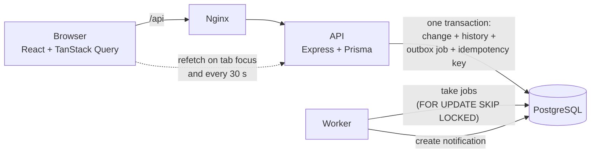

# Operations Under Pressure

An internal web app where teams create, assign, track and resolve operational work items
(incidents, customer issues, payments, compliance checks, tasks).

It focuses on getting the hard parts right: two people claiming the same item, editing an item that just
changed, double clicks, who may see and do what, and notifications that survive a crash.

- **Backend:** Node.js, Express, TypeScript, PostgreSQL, Prisma
- **Frontend:** React (Vite), TanStack Query
- **Background work:** a Postgres "outbox" table and a worker process
- **Tests:** Vitest and Supertest (126 API tests)

## Run it (one command)

Prerequisite: Docker with Docker Compose.

```bash
cp .env.example .env        # on Windows PowerShell: Copy-Item .env.example .env
docker compose up --build
```

Then open **http://localhost:8080**.

The first start builds the images, creates the tables, and fills the database with demo data
(4 teams, 10 users, 4000 work items). Later starts keep your data. To start again from scratch:
`docker compose down -v`.

| Part | Address | What it is |
|---|---|---|
| Web app | http://localhost:8080 | The React app (nginx also forwards `/api` to the API) |
| API | http://localhost:4000 | REST API. `GET /health` checks it and the database |
| Database | localhost:5432 | PostgreSQL |
| Worker | none | Turns saved jobs into notifications |

If a port is taken, set `WEB_PORT`, `API_PORT` or `DB_PORT` in `.env`.

## Demo logins

Password for every demo user: `Password123!` (the login page also has buttons that fill these in).

| Email | Who | Teams and roles |
|---|---|---|
| `admin@demo.com` | Admin | Everything, in every team |
| `lead.ops@demo.com` | Liam Lead | Operations: Lead |
| `lead.payments@demo.com` | Priya Lead | Payments: Lead |
| `lead.compliance@demo.com` | Carlos Lead | Compliance: Lead |
| `lead.support@demo.com` | Sara Lead | Customer Support: Lead |
| `member.ops@demo.com` | Mia Member | Operations: Member |
| `member.payments@demo.com` | Noah Member | Payments: Member, Customer Support: Member |
| `member.compliance@demo.com` | Olivia Member | Compliance: Member |
| `member.support@demo.com` | Ethan Member | Customer Support: Member, Operations: Viewer |
| `viewer@demo.com` | Vera Viewer | Operations: Viewer |

Things worth trying:

1. **Two people claim the same item.** Open two browsers (or a private window) as `member.ops@demo.com`
   and `lead.ops@demo.com`, open the same unassigned item, and press **Claim** in both. One wins, the other
   sees "Already claimed by ...".
2. **Stale edit.** Open the same item as two users, edit and save in one, then save in the other. The second user
   is told the item changed and can choose to use the latest values or keep their edits.
3. **Approval.** As `member.payments@demo.com`, take a *Payment* item to **In progress**, then **Request approval**.
   `lead.payments@demo.com` gets a notification, and can approve or reject (a reason is required to reject).
   A Lead cannot approve an item assigned to themselves.
4. **Other teams are invisible.** `member.compliance@demo.com` gets "Item not found" for a Payments item.

## Run it for development (without Docker for the app)

```bash
cp .env.example .env
cp backend/.env.example backend/.env      # set JWT_SECRET; the database password must match the root .env
docker compose up -d db                   # just the database

cd backend
npm install
npx prisma migrate deploy                 # create the tables
npm run db:seed                           # demo data (wipes existing data first)
npm run dev                               # API on :4000
npm run dev:worker                        # in a second terminal

cd ../frontend
npm install
npm run dev                               # http://localhost:5173 (forwards /api to :4000)
```

## Run the tests

The tests need the database running (`docker compose up -d db`) and `backend/.env` in place.
They use their own database, `newtonite_test`, created automatically, so your demo data is never touched.

```bash
cd backend
npm install
npm test                  # all 126 tests
npm run typecheck
```

What the tests cover (the dangerous behaviours, not "the page loads"):

| Area | Examples |
|---|---|
| Concurrency | Two and five simultaneous claims: exactly one wins. Forced races where both requests read the item before either writes. Two edits with the same version: one is rejected |
| Duplicates | Same `Idempotency-Key` twice, and five at the same moment: one item, one comment |
| Workflow | Open to Closed is rejected, Closed is final, approval cannot be skipped for Payment/Compliance, nobody approves their own item |
| Access | Outsiders get 404 on every read and write; the permission matrix per role |
| Reliability | Worker retries with growing waits, gives up after 5 attempts, a job run twice makes one notification, a crashed worker's job comes back |
| Data | Filters, search, cursor paging while data changes, dashboard counts equal list counts |

The frontend is checked with `npm run lint` and `npm run build` (in `frontend/`). It has no automated UI tests.

## How it works



**Status flow**

```
Open -> In progress -> Resolved -> Closed (final)
                   \-> Awaiting approval -> Resolved      (Payment and Compliance only)
                                         \-> In progress  (rejected, reason required)
Resolved -> In progress (reopen).     Release: In progress -> Open, owner removed.
```

**Roles** are per team: Viewer (read and comment), Member (also create, claim, and change their own items),
Lead (also assign, approve, change any item, move items between teams). Admin is a flag on the user and counts
as Lead in every team. All checks go through one function, `can(user, action, item)`, in
`backend/src/permissions/can.ts`. The UI hides buttons for convenience, but the server checks every request.

**API** (all except login and health need `Authorization: Bearer <token>`):

| Endpoint | Purpose |
|---|---|
| `POST /auth/login`, `GET /me` | Log in; who am I, my teams and roles |
| `GET /dashboard` | Counts for: assigned to me, unassigned urgent, awaiting my approval, overdue |
| `GET /items` | List. Filters `teamId status priority type assignee`, search `q`, `view`, `cursor`, `limit` |
| `POST /items` | Create (`Idempotency-Key` header) |
| `GET /items/:id`, `PATCH /items/:id` | Detail (with what you may do); edit (needs `version`) |
| `POST /items/:id/claim`, `/release` | Take or give up an item |
| `POST /items/:id/assign`, `/transition` | Lead assigns; change status (both need `version`) |
| `GET /items/:id/activity` | History, newest first, paged |
| `GET/POST /items/:id/comments` | Comments (`Idempotency-Key` on POST) |
| `GET /teams/:id/members` | People for the assign list |
| `GET /notifications`, `POST /notifications/:id/read` | My notifications |

Responses look like `{ "success": true, "data": ..., "error": null, "meta": ... }`. Errors have `error.code`
and `error.message`; a `409` on a stale edit also carries the latest item in `error.current`.

## Project layout

```
backend/
  prisma/        schema, migration, seed
  src/auth/        login, token check, loads the user's team roles
  src/permissions/ can() and the allowed status moves
  src/items/       list/search, create, claim, assign, transition, edit, history
  src/outbox/      job queue and the worker
  tests/           API tests
frontend/src/      pages, components, data hooks (api/)
docker-compose.yml
ENGINEERING_DECISIONS.md
```

## Known limitations

Be honest about what this is: a focused v1.

- **No user management.** No sign-up, password reset or role editing screens. Users come from the seed.
- **Login token is kept in `localStorage`** (simple, but readable by script if the site had an XSS bug), and
  there is no refresh or "log out everywhere". Tokens last 8 hours. Roles are re-read on every request, so a
  role change or a removed user takes effect immediately.
- **Idempotency keys** are matched on user and key only. Re-using a key with a *different* body returns the
  first response instead of an error.
- **Notifications can be a few seconds late** (the worker polls every second) and in-app only (no email).
  Delivery is at-least-once, so handlers are written to be safe to run twice.
- **If a team has no Lead other than the assignee**, nobody is notified that approval is needed (an Admin still
  sees it under "Awaiting my approval").
- **Search** uses English word stemming and matches the start of words. It does not tolerate typos, rank
  results, or search comments.
- **Moving an item to another team** removes its owner and reopens it, because the owner may not belong to the
  new team.
- **Rate limiting** is in memory per process, so it is not shared if you run several API copies.
- **The containers run the TypeScript with `tsx`** instead of a compiled build, to keep the Docker setup simple.
- **`npm audit`** reports `deepmerge-ts` (inside the Prisma command-line tool, not used on user input). The
  fix is a major Prisma upgrade, which I did not risk before the deadline.
- **The demo password** is shown on the login page. Remove that for a real deployment.
- **No automated UI tests.** The API is tested in depth; the UI is only checked by type-checking, linting and
  building, so it deserves a manual walk-through.
- **AWS** is not part of the build. At 10x scale: RDS with read replicas, SQS instead of the outbox table,
  ECS for the API and worker, a search engine for text search, and partitioning the history table.
